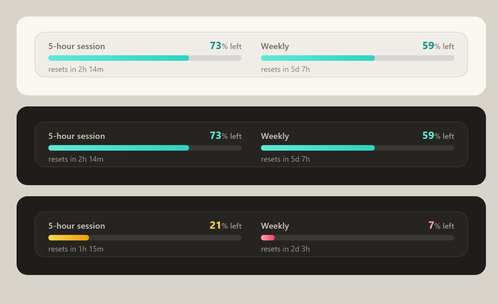

# usage-band

A soft, modern usage card that sits right above the Claude Code prompt.



- **Remaining usage, not used.** Each limit (5-hour session, weekly, spend) is a slim gradient bar with a big "% left".
- **Reset time at a glance.** `resets in 2h 14m` under every bar.
- **Calm colors that warn.** Teal when you have plenty, amber under 30%, rose under 10%.
- **Light and dark.** The card is translucent and follows the app's mode.
- **Terminal friendly.** In a plain terminal (no graphics) it falls back to compact text bars.

It is a Claude Code "mod": one hook on the `AbovePrompt` slot, a few dozen lines, no dependencies, and it reads only the rate-limit numbers Claude Code already has. Nothing is sent anywhere.

## Install

At the prompt of a terminal session:

```
/plugin install usage-band --marketplace idanam2/claude-usage-band
```

From a shell:

```
claude plugin install usage-band --marketplace idanam2/claude-usage-band
```

In the desktop app, where `/plugin` does not run: click **+** next to the prompt box, then **Plugins**, **Add marketplace** with `idanam2/claude-usage-band`, then **Add plugin**.

## Customize

Everything visual lives in [`hooks/bar.ts`](hooks/bar.ts): sizes, labels, the three color tones and the SVG styles. `hooks/register.tsx` only feeds it the numbers.

## Credits

Inspired by the status-line projects the community loves: [claude-hud](https://github.com/jarrodwatts/claude-hud) and [ccstatusline](https://github.com/sirmalloc/ccstatusline).

## License

MIT
